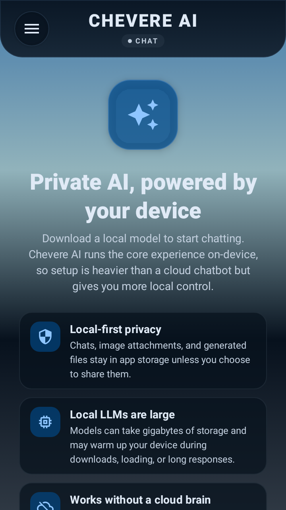
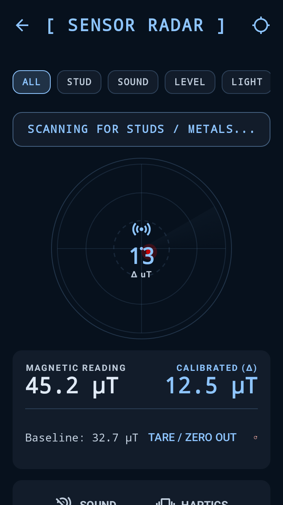
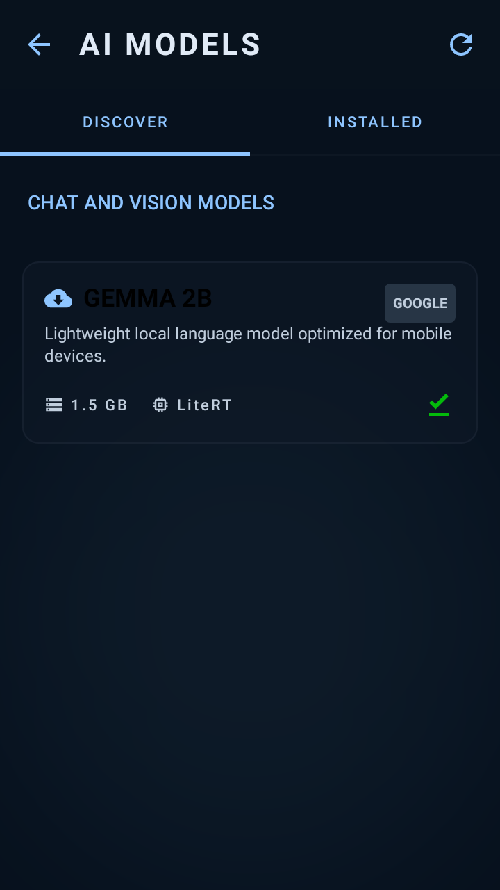
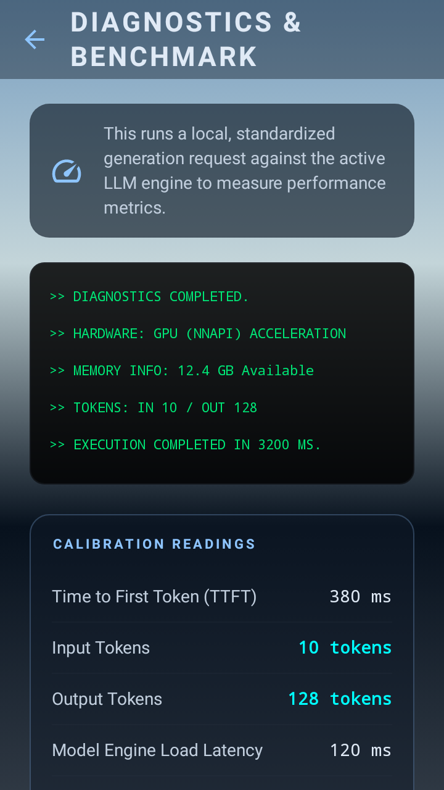
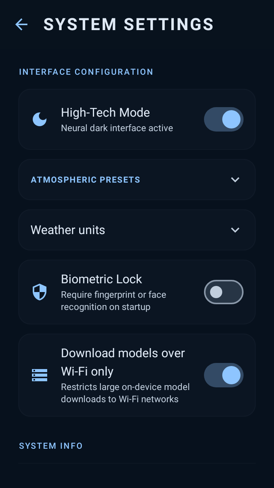
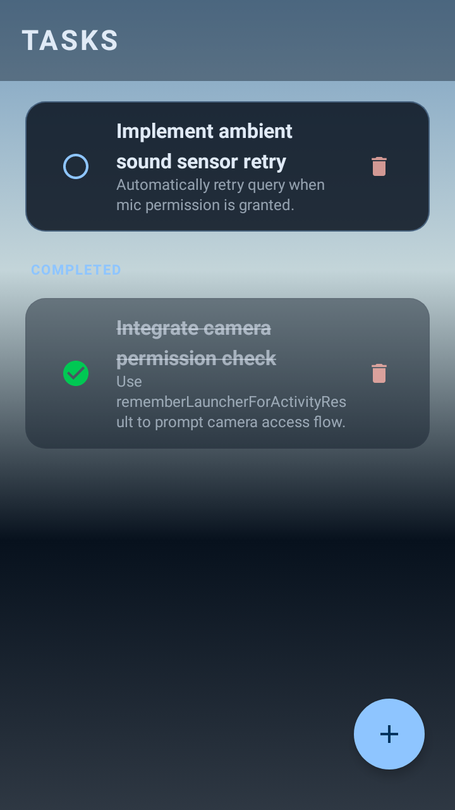
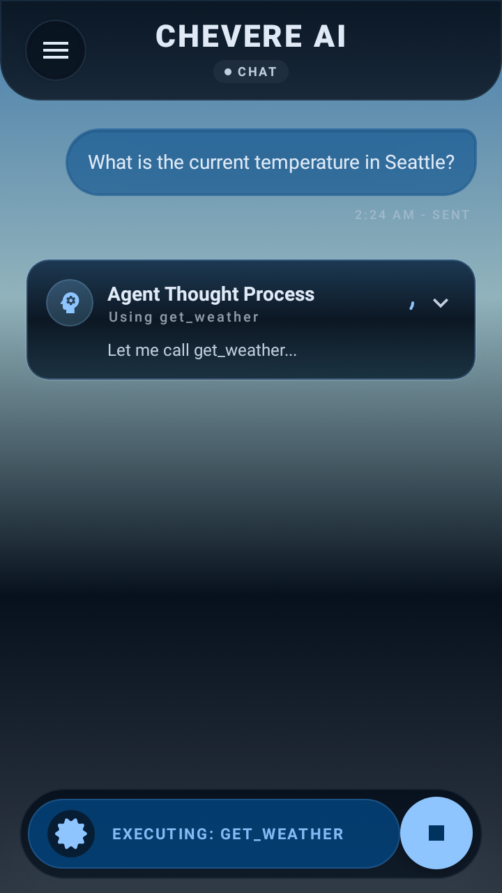
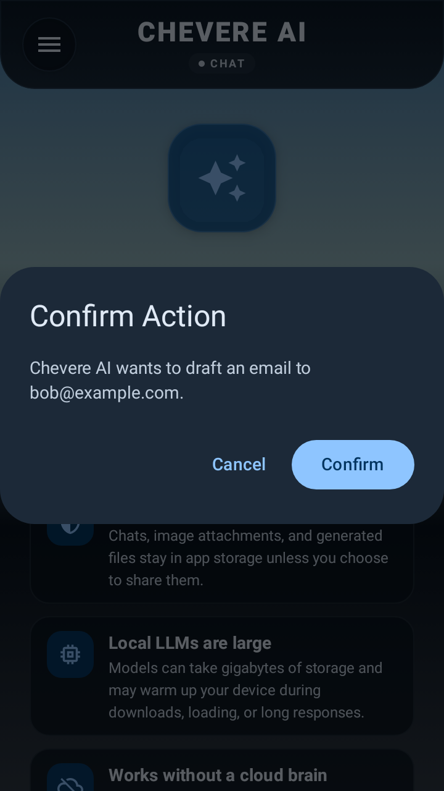
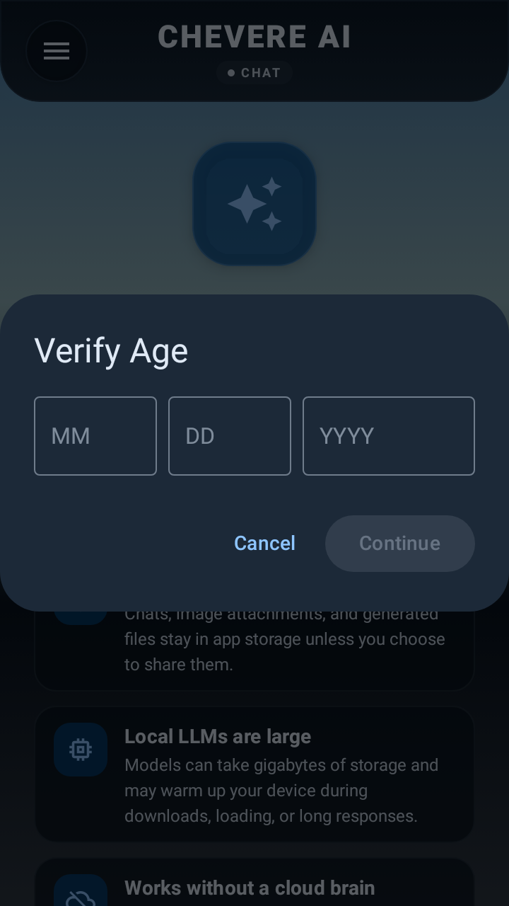

# Chevere AI

Chevere AI is a privacy-first Android assistant that runs local AI models on device. It combines chat, multimodal vision, agent tools, inline A2UI task checklists, device actions, hardware sensors, and model management in one Kotlin Multiplatform-ready app, with local ONNX Stable Diffusion isolated in a standalone `:image-generation` module for optional future activation.

The project is built for experimenting with capable on-device assistants: small enough to run locally, but structured enough to support real app features like downloads, permissions, background work, model health, in-app AI safety reporting, and a Compose UI.


---

## Screenshots

<details>
<summary><b>📱 Core App Screens (Click to expand)</b></summary>
<br/>

<p align="center">
  
  
  
</p>
<p align="center">
  
  
  
</p>
</details>

<details>
<summary><b>🤖 AI Agent & Chat Interactions (Click to expand)</b></summary>
<br/>

<p align="center">
  
  
  
  
</p>
</details>

---

## What It Can Do

- **Local LLM Chat**: Chat with local LiteRT-LM models such as Gemma.
- **Multimodal Vision**: Attach camera or gallery images for vision-capable models.
- **Natural Language Agent**: Run an agent reasoning loop (Reason-Act-Observe) that can search the web, check weather, summarize text, manage tasks (with interactive A2UI checklists in chat), draft emails, open apps, copy/share text, and use Android intents.
- **Hardware Sensors**: Read ambient light, atmospheric pressure, battery level/thermals, CPU temperatures, compass heading, accelerometer, gyroscope, posture, flatness, magnetic field strength, and ambient sound level (dB SPL).
- **Visual Radar Dashboard**: Launch real-time visual tools: stud finder/metal detector, spirit level (bubble level), light meter, and proximity detector.
- **Model Marketplace**: Discover, download, verify (SHA-256), and extract models atomically.
- **In-App AI Content Reporting**: Flag inaccurate, offensive, or unsafe AI responses directly from any assistant message bubble (`ReportAiContentDialog` → `AiContentReportRepository`), scrubbing PII before logging to Firebase Analytics and Firestore.
- **Modularized Stable Diffusion (`:image-generation`)**: Local ONNX Stable Diffusion runtime (`OnnxLocalDiffusionEngine`) is packaged in a standalone `:image-generation` Gradle module, currently decoupled from `:app` to keep the primary app binary slim and focused on chat, vision, and tools.
- **Data & RAM Savers**: Background context summarization to keep context windows small, automatic background memory unloading, and Wi-Fi-only download controls.
- **Local Benchmarking**: Measure warmup times, Time to First Token (TTFT), tokens per second throughput, and RAM usage on your device.

---

## User Guide: How to Use Chevere AI

### 1. First-Time Setup & Downloading Models
1. **Launch the App**: When you first open the app, it will search for installed models. If none are found, you will be prompted to download one.
2. **Go to the Marketplace**: Navigate to the **Marketplace** screen to discover available chat and vision models.
3. **Configure Download Constraints**: Open the **Settings** screen (gear icon) and ensure **"Download models over Wi-Fi only"** is toggled on if you want to avoid cellular data charges. When active, WorkManager will restrict large model downloads (often > 1GB) to Wi-Fi networks and require that your device is not low on battery or storage.
4. **Download and Activate**: Tap download on a chat model (like `Gemma`). Once verified and extracted, it will automatically activate as the default chat model.

### 2. Multi-Modal Chat, Sharing & Reporting
* **Attach Images**: Tap the paperclip icon in the chat bar to capture a photo using your **Camera** or select an image from your **Gallery**. Ask the model to describe or explain the image (requires a vision-supported model).
* **Share & Report**: Tap the **Share** icon on any assistant message to share it via Android's native share sheet, or tap the **Flag** icon to report an inaccurate, offensive, or unsafe AI response.

### 3. Slash Commands & Autocomplete
Chevere AI features an **interactive autocomplete popup** for quick shortcuts. Type a slash (`/`) in the chat bar to open the popup menu and select a command:
* `/sensors`: Navigates to the full **Sensor Radar** dashboard.
* `/stud` or `/metal`: Launches the visual **Stud Finder** & magnet detector screen.
* `/level`: Launches the **Spirit Level** / pitch & roll bubble level.
* `/light`: Opens the **Light Meter** to view ambient lux.
* `/proximity`: Opens the **Proximity Detector**.

### 4. Natural Language Agent Tools
You can trigger complex local actions simply by chatting with the assistant:
* **Check the Weather**: Ask *"How's the weather in Seattle?"* or *"What's the weather like here?"* (The agent will geocode locations online or ask for location permission to query Seattle or your device coordinates via Open-Meteo).
* **Look Up & Email Contacts**: Say *"Find Bob's email"* or *"Draft an email to Alice"*. The assistant will ask for contacts permission, resolve the name, retrieve the email, and draft the email ready to send.
* **Manage Tasks**: Speak *"Add buy groceries to my tasks"* or *"Show my pending tasks"*. The agent connects with the local database to create, list, toggle, or delete items and renders interactive A2UI checklists inline in chat.
* **Hardware Sensors**: Ask *"How's the light in my room?"*, *"What is my battery level?"*, *"Is my phone face down?"*, or *"Can you detect metal?"*.
* **Device Control**: Ask the agent to *"turn on Do Not Disturb"* or *"mute my media volume"*.

### 5. Memory Management & Background Unloading
* **Background Context Summarization**: As your conversation gets longer, Chevere AI automatically condenses older messages into a compact background memory capsule, keeping Gemma's context footprint small to prevent model stuttering.
* **Automatic RAM Reclaim**: Local LLMs occupy significant system RAM. If Chevere AI is sent to the background (app minimized) for **more than 3 minutes**, the app automatically unloads active models to free up resources. They will reload transparently when you return.

### 6. Local Benchmarking
Want to test how fast local models run on your hardware?
1. Navigate to **Settings** -> **Benchmark**.
2. Tap **Run Benchmark**.
3. The screen will report hardware statistics (Acceleration type, available RAM) and run test inference loops to measure **warmup time**, **Time-To-First-Token (TTFT)**, and **Tokens-Per-Second (TPS)** throughput.

---

## Document Search and MCP

Import a UTF-8 `.txt` or `.md` file (up to 2 MB) through **Add attachment → Import document**, then ask:

```text
/docs What is the warranty policy in policy.md?
```

Chevere searches its local document index and supplies up to three excerpts to the local model. This uses keyword matching, not semantic embeddings. PDF extraction and whole-document summaries are not implemented.

To discover tools on a remote MCP server, supply its HTTPS endpoint in chat:

```text
/mcp list tools at https://your-server.example/mcp
```

Replace the example endpoint with your server. Confirm the connection, then request a discovered tool by name and confirm the call. Remote MCP operations send requests to that server; the local document index is not automatically uploaded. This initial bridge has no saved connections or OAuth/API-token setup.

See [RAG/MCP usage and limitations](docs/rag-mcp.md) for supported behavior and validation coverage.

## Tech Stack

- **Language**: Kotlin (Android + Kotlin Multiplatform `:shared` core)
- **UI**: Jetpack Compose, Material 3, AndroidX Compose A2UI
- **Architecture**: Clean Architecture, MVI
- **Dependency injection**: Hilt
- **Local LLM runtime**: Google AI Edge LiteRT-LM & MediaPipe GenAI
- **Optional Image runtime (`:image-generation`)**: ONNX Runtime Android (standalone module, currently disabled in `:app`)
- **Storage**: Room & DataStore Preferences
- **Background work**: WorkManager foreground services (`dataSync`) for safe, resumable downloads
- **Networking**: Ktor and OkHttp
- **Modules**: `:app`, `:shared`, `:ui-designsystem`, `:image-generation`, `:baselineprofile`

---

## Model Support

Chevere AI supports:

- `.litertlm` chat/vision models (active in `:app`).
- `.bin` legacy/local LiteRT-compatible models (active in `:app`).
- Extracted ONNX diffusion directories (supported by the standalone `:image-generation` module when enabled) containing:
  - `text_encoder/model.ort` (or `model.onnx`)
  - `tokenizer/vocab.json`
  - `tokenizer/merges.txt`
  - `unet/model.ort` (or `model.onnx`)
  - `vae_decoder/model.ort` (or `model.onnx`)

---

## Getting Started

Clone the repository and build the debug APK:

```bash
./gradlew assembleDebug
```

On Windows PowerShell:

```powershell
$env:GRADLE_USER_HOME="$env:USERPROFILE\.gradle"; .\gradlew.bat assembleDebug --no-daemon
```

Then install the debug APK, open the model marketplace, and download or add a supported local model.
*Note: Firestore-backed discovery catalog and AI content report syncing require `google-services.json` in `app/`.*

---

## Common Development Commands

```bash
# Build debug APK
./gradlew assembleDebug

# Build standalone image-generation module
./gradlew :image-generation:assembleDebug

# Run unit tests
./gradlew test

# Run Android instrumented tests
./gradlew connectedAndroidTest

# Run code linter
./gradlew lint

# Clean build directory
./gradlew clean
```

---

## Project Layout

```text
app/src/main/java/com/neo/chevere/
  data/       agent tools, inference, AI content reporting, model downloads, Room database, repositories
  domain/     shared models, repository interfaces, model metadata, permission wrappers
  ui/         Compose screens, A2UI surfaces, ViewModels, and MVI contracts

shared/
  Kotlin Multiplatform shared chat orchestration, domain models, and runtime abstractions

ui-designsystem/
  shared theme, typography, and reusable UI components

image-generation/
  standalone ONNX Runtime Android local Stable Diffusion engine (OnnxLocalDiffusionEngine)

distribution/
  Play Store listing copy, Privacy Policy, and Google Play Console submission checklist
```

---

## Notes

- **Offline-First**: Core AI inference happens locally on device. Network access is used only for model downloads, weather geocoding, web search (`WEB_SEARCH_PROXY_URL` / debug `SERPER_API_KEY` / key-less DuckDuckGo fallback), and optional AI safety reports.
- **Google Play Readiness**: See [`distribution/GOOGLE_PLAY_CHECKLIST.md`](distribution/GOOGLE_PLAY_CHECKLIST.md) for Data Safety answers, AI-Generated Content policy compliance, and Foreground Service declaration instructions.

---

## License

This project is licensed under custom terms. It is free to clone, modify, and run for personal, private, and educational use, but distribution or publishing (including to the Google Play Store or other marketplaces) is strictly prohibited. See [LICENSE](LICENSE) for full details.
